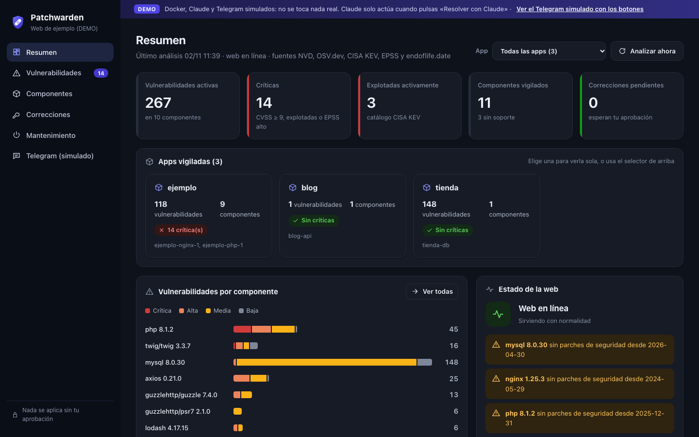

<p align="center">
  
</p>

<h1 align="center">Patchwarden</h1>

<p align="center">
  <b>Finds vulnerable software in your Docker sites. Prepares the fix. You approve it.</b>
</p>

<p align="center">
  
  
  
  <a href="LICENSE"></a>
</p>

---

Patchwarden is a small container that runs next to your websites. It works out which software
versions they use, checks them against public vulnerability databases, warns you when something
is at risk and, when you ask, gets Claude to prepare a tested fix. **Nothing changes on your server
until you approve it.**

<p align="center">
  
</p>

## What it does

1. **Finds what you run.** It detects PHP, nginx, Java, Tomcat, Node and more, plus your
   Composer, npm, Maven and PyPI dependencies, from your containers and project files.
2. **Checks it.** It cross-checks every version against **NVD, OSV.dev, CISA KEV, EPSS and
   endoflife.date**, and puts first what attackers are already exploiting.
3. **Warns you.** In the web dashboard and, if you want, on Telegram, by webhook or by email.
   It can also put your site into **maintenance mode**.
4. **Fixes on request.** Click *Resolver con Claude* (“Resolve with Claude”) and Claude prepares the changes. Each one
   explains what it fixes, why it is correct, how risky it is and how to undo it.
5. **Tests before you decide.** Patchwarden applies the changes to a copy of your project and
   runs it in test containers.
6. **Applies only what you approve.** You approve or reject each change from the dashboard or
   Telegram. It takes a backup, checks that the site is still up and rolls back if it is not.

> **Claude never acts on its own.** It only works when you click the button and confirm, and it
> only proposes. It has no terminal and no access to your files.

## Install on a server

Patchwarden has two parts, and the installer sets up either one:

- **Central dashboard** (`central/`): the web dashboard. It watches its own server, receives the
  agents and prepares fixes with Claude. You need one.
- **Agent** (`agente/`): a small client for each additional server. It detects, tests and applies on
  that server and only makes outgoing connections to the dashboard, so no ports need to be opened.
  It has no dashboard and never runs Claude.

On a Linux server with Docker:

```bash
curl -fsSL https://raw.githubusercontent.com/xv0rtex/patchwarden/main/instalar.sh | bash
```

The script shows a menu. On a new server it asks what to install. For the dashboard it **finds
the apps already running in Docker**, picks a free port, writes the configuration and a
password, and starts everything. At the end it prints the dashboard URL, the username and the
password. It also asks for a Telegram bot token and a Claude Code token; both are optional.

To add another server, open *Ajustes › Equipos* (Settings › Servers) in the dashboard. It gives you a
one-time command for that server:

```bash
curl -fsSL https://raw.githubusercontent.com/xv0rtex/patchwarden/main/instalar.sh | bash -s -- --agente --central https://your-dashboard --codigo CODE
```

### Updating

Each installation keeps a copy of the installer in its folder (`/opt/vigilante` and
`/opt/vigilante-agente` as root, or the same names under your home folder). Run it to open the menu:

```bash
bash /opt/vigilante/instalar.sh                 # menu
bash /opt/vigilante/instalar.sh --actualizar    # update without questions
```

| Menu entry | What it does |
|---|---|
| Update | Downloads the latest code from GitHub, rebuilds and redeploys. Tokens, the dashboard account, data, scan results and agent registrations are kept. If the new version does not start, it goes back to the previous one. |
| Update and look for apps again | The same, and it also finds apps you have added or removed |
| Change tokens | Changes the Telegram or Claude Code token without reinstalling |
| Stop / Start / Uninstall | Uninstalling asks you to type `borrar` (delete) because it removes the data |

After an update, the scan is not repeated if the last one is recent and nothing has changed on the
server.

| Option | What it does |
|---|---|
| `--panel` / `--agente` | Install the dashboard or the agent without the menu |
| `--central URL --codigo CODE` | Agent: dashboard URL and one-time registration code |
| `--actualizar` / `--reconfigurar` | Update / update and look for apps again |
| `--permitir-aplicar` | Allows approved changes to be applied (with backup and rollback) |
| `--puerto N` | Dashboard port |
| `--local` | Dashboard only on `127.0.0.1` |
| `--solo NAME` | Watches a single app or project |
| `--tunel` | Publishes the dashboard through a free Cloudflare quick tunnel |
| `--permitir-http` | Agent: allows an `http://` dashboard URL (only inside a private network or VPN) |
| `--estado` / `--url` / `--parar` / `--desinstalar` | Status / tunnel URL / stop / remove |
| `--sin-preguntas` | Never asks anything (for scripts) |

Each Docker Compose project counts as an *app*, and the dashboard lets you view one or all of them.

## Fixes with Claude Code (no API billing)

Fixes use **Claude Code with your Claude subscription** (Pro, Max or higher), not the pay-as-you-go
API. On the computer where you use Claude, create a token:

```bash
claude setup-token
```

Put it in the `.env` file as `CLAUDE_CODE_OAUTH_TOKEN`, or paste it when the installer asks.

- Each fix uses part of your plan's usage limits.
- Any `ANTHROPIC_API_KEY` in the environment is deliberately ignored, so you are never billed per use.
- Claude runs in an empty folder, with only web search and web fetch (to read changelogs and
  upgrade guides). It cannot run commands or open your files.
- Patchwarden sends the vulnerabilities and deployment files (`composer.json`, `Dockerfile`, nginx
  config…), never `.env` files or app data. The confirmation window tells you this before anything
  is sent.
- The token is for **your own** use. If someone else installs Patchwarden, they should use their own
  Claude account.

Without a token, Patchwarden still detects and warns; it just does not prepare fixes.

## Try it with the example

```bash
cd ejemplo
cp .env.ejemplo .env      # Telegram, CLAUDE_CODE_OAUTH_TOKEN, dashboard token… (all optional)
docker compose up -d --build
# Website:   http://localhost:8000
# Dashboard: http://localhost:8080
```

Run `docker compose` **from the `ejemplo/` folder**: the project is mounted at the same path as on
the host, so approved changes can be deployed from inside the container.

## Security model

- **Read-only by default.** Patchwarden only reads the Docker API through a proxy that allows
  listing and inspecting containers.
- **Writing is opt-in.** Testing and deploying need a second Docker proxy with write access,
  which is close to root on the server. Safer alternatives: run the tests on another machine
  (`VIGILANTE_DOCKER_PRUEBAS=tcp://test-host:2375`), deploy through your own CI/CD
  (`[aplicacion].webhook_despliegue`), and mount your code read-only.
- **Every change needs your approval**, with a backup first and an automatic rollback if the
  site stops responding.
- **One dashboard account with a normal login.** The password is stored with scrypt. Sessions use
  `HttpOnly`/`SameSite=Strict` cookies and every form carries a CSRF token. After 10 failed
  attempts an address is locked out for 5 minutes. If the installer did not set a password, the
  first visit asks you to create the account with a one-time code printed in the container log.
- **Agents do not blindly trust the dashboard.** An agent only applies a change whose verification
  it ran itself, reverts from its own backup, only touches its own project folders, and refuses to
  apply anything when it is installed in proposals-only mode. Agent tokens are stored hashed and
  revoking a server in *Ajustes › Equipos* cuts it off immediately.

## Add it to an existing site

1. Copy the `vigilante/` and `central/` folders next to your `docker-compose.yml`
   (build with `context: .` and `dockerfile: central/Dockerfile`).
2. Add the `docker-proxy` and `vigilante` services from the example, and the label
   `vigilante.vigilar: "true"` to your site's containers.
3. Mount your code (to read `composer.lock`, `package-lock.json`, `pom.xml`…). Mount it read-only
   if you only want proposals.
4. Describe in `[[verificacion.servicios]]` how to build and test each service, and in
   `[aplicacion]` how to deploy and where to check the site.
5. For maintenance mode, share the `mantenimiento` volume with nginx and add the lines from
   `ejemplo/web/nginx/default.conf`.

## Demo

A fully simulated demo (Docker, Claude and Telegram are fake, nothing real is touched):

```bash
bash demo/arrancar.sh     # dashboard on :8090 plus a tunnel; prints URL, user and password
bash demo/parar.sh        # stops everything
```

Visit `/demo` to see the simulated Telegram bot with its approve, reject, apply and revert buttons.
The demo also has a second, simulated server (`srv-madrid`) with a real agent connected over HTTP,
so you can request, approve and apply a fix on a remote server.

## Settings

Everything you would otherwise edit in `vigilante.toml` can be changed in *Ajustes* (Settings), and
it takes effect at once, without a restart: Telegram (with a "send a test message" button),
webhook and email, the Claude Code token and default model, Claude usage history, alert rules,
servers with agents, and your password. A value set through an environment variable is shown
locked. Secrets are never sent back to the browser.

## Run without Docker

```bash
cd vigilante
python3 -m vigilante -c ../ejemplo/vigilante.toml --detectar   # just show what it detects
python3 -m vigilante -c my.toml --una-vez                       # one cycle (exit code 2 if critical)
python3 -m vigilante -c my.toml                                 # service + dashboard
```

## Tests

```bash
python3 -m unittest discover -s pruebas    # unit tests
python3 pruebas/prueba_flujo.py            # full flow with simulated Docker, Claude Code and Telegram
PRUEBA_AGENTE=1 python3 pruebas/prueba_flujo.py   # the same flow with a central dashboard + agent over HTTP
```

`pruebas/prueba_navegador.py` tests the dashboard in Chromium (needs Playwright).

## Project layout

| Path | Contents |
|---|---|
| [`central/`](central/) | Image of the central dashboard (includes Claude Code) |
| [`agente/`](agente/) | Image of the agent installed on each additional server (no dashboard, no Claude) |
| [`vigilante/`](vigilante/) | Shared Python code: detection, sources, dashboard, agent, Claude Code integration |
| [`instalar.sh`](instalar.sh) | Installer and updater for both |
| [`ejemplo/`](ejemplo/) | A PHP + nginx site ready for `docker compose` |
| [`demo/`](demo/) | The simulated demo |
| [`pruebas/`](pruebas/) | Tests and simulators |
| [`docs/DISENO.md`](docs/DISENO.md) | Full design document |

> The dashboard, notifications, configuration keys and design document are currently in Spanish.

## License

[MIT](LICENSE)
